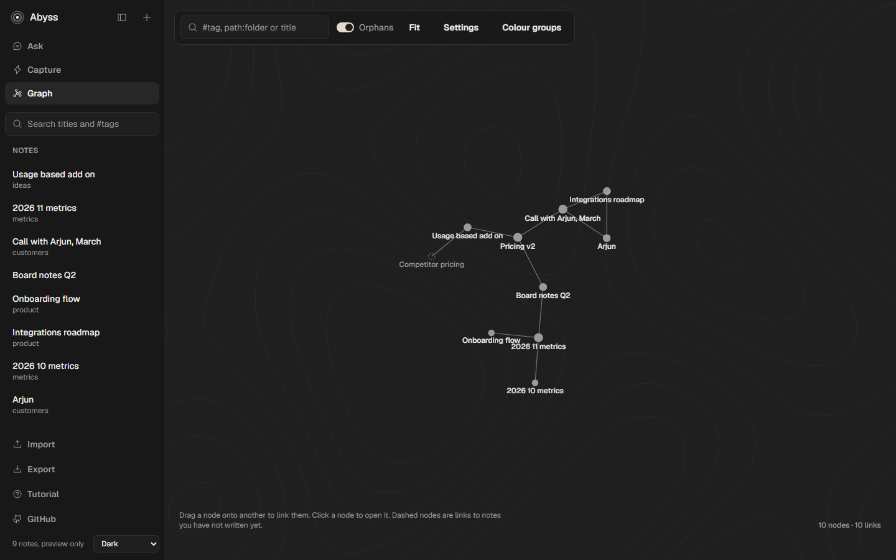
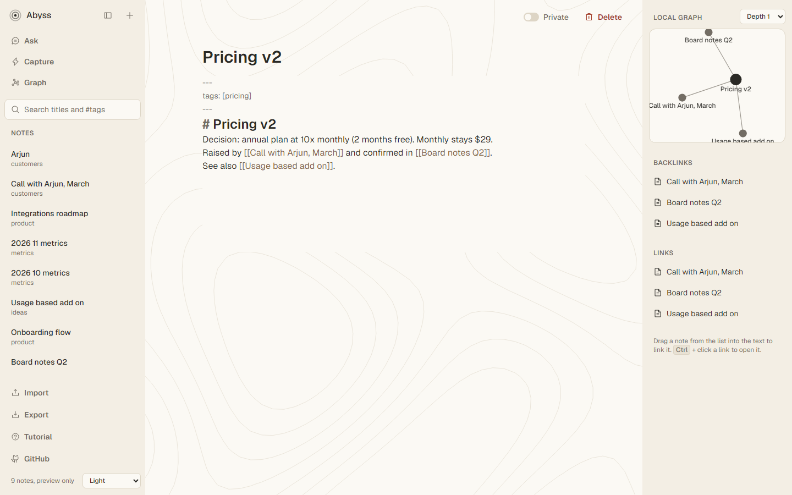
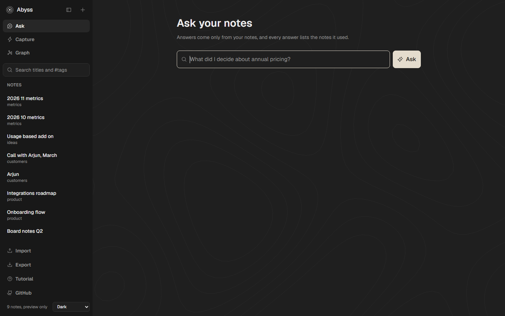
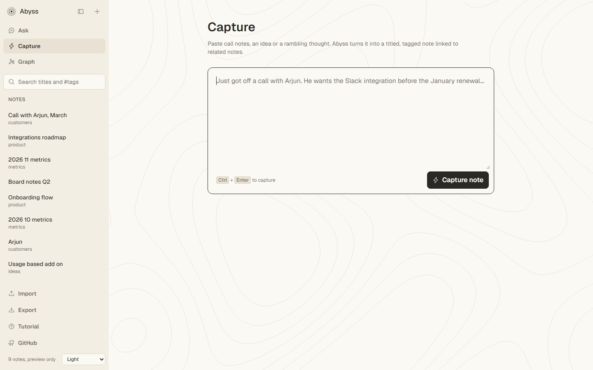
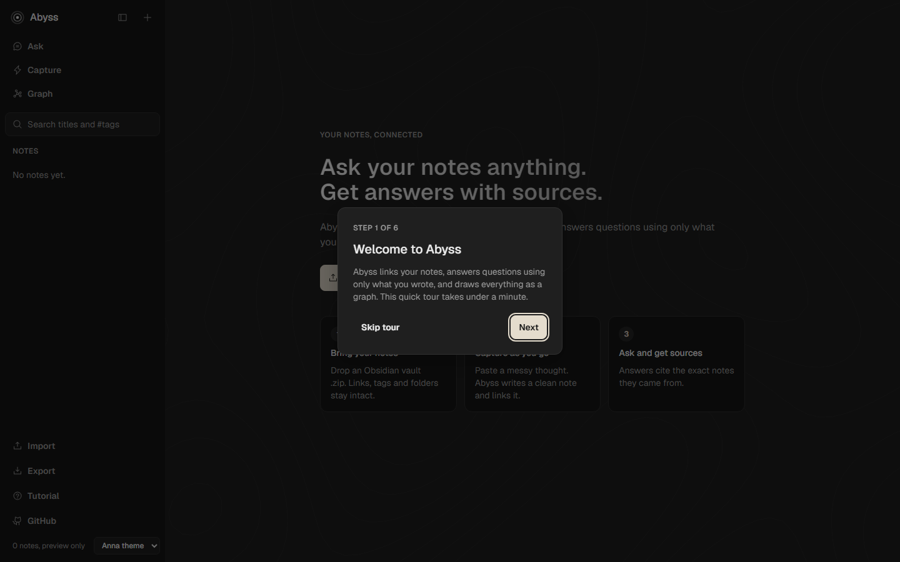

<div align="center">


# Abyss

**Interconnected notes that answer back.**

Linked markdown notes, cited answers from your own notes, and a live knowledge graph. Built as an [Anna](https://anna.partners) App. Bring your Obsidian vault, take it back out any time.




</div>

---

## Why Abyss

Most notes become a write only graveyard: disconnected, hard to search, and invisible to the tools you use every day. Abyss turns a pile of notes into something you actually use.

- **Ask your notes.** Get an answer built only from what you wrote, with the exact notes it used listed underneath. If the answer isn't in your notes, it says so.
- **Capture without friction.** Paste a messy thought or call notes. Abyss writes a clean, titled, tagged note and links it to related notes.
- **See how it connects.** Every `[[link]]` becomes an edge in an Obsidian style graph. Drag one node onto another to link them.
- **No lock in.** Import an Obsidian vault (`.zip`) or a public GitHub repository, and export everything back to markdown whenever you want.

## Screenshots

<table>
  <tr>
    <td width="50%"><br /><sub><b>Editor.</b> Markdown with <code>[[links]]</code>, backlinks, and a local graph. Sand and charcoal light theme.</sub></td>
    <td width="50%"><br /><sub><b>Ask.</b> Answers come only from your notes, with sources.</sub></td>
  </tr>
  <tr>
    <td width="50%"><br /><sub><b>Capture.</b> Messy text in, clean linked note out.</sub></td>
    <td width="50%"><br /><sub><b>First run.</b> Import a vault or write a note, with a short guided tour.</sub></td>
  </tr>
</table>

## Features

| | |
|---|---|
| **Notes** | Markdown editor (CodeMirror 6) with `[[` autocomplete, backlinks, `#tags`, folders, a per note private flag, and link safe renames that rewrite every note pointing at the old title |
| **Obsidian interop** | Import and re-import a vault `.zip` (links, tags, folders and frontmatter kept; your edits are never overwritten), export back to a `.zip` |
| **GitHub import** | Import the markdown files of any public repository: `owner/repo`, `owner/repo@branch`, or a URL |
| **Ask** | Retrieval with embeddings, then an answer that cites only notes that were really provided. Falls back gracefully and never ends in an error screen |
| **Capture** | Turns messy text into a clean note with a title, tags and links to related notes. If the model is unavailable, your text is saved unchanged |
| **Graph** | Whole vault and local graph with depth control, filters (`#tag`, `path:folder`), colour groups, orphan toggle, force and display settings, and drag to link |
| **Anna chat access** | The `abyss-tools` Executa lets Anna's assistant search, read, create and append notes. On for chat by default, off for other apps until you allow it, and notes marked Private are never exposed. Included in this repository but not part of the first published version (the Privacy panel is hidden until it ships) |
| **Interface** | Light (sand and charcoal) and dark themes that can follow Anna, a collapsible sidebar (`Ctrl+B`), a first run tutorial, and reduced motion support |

## Quick start

Requirements: Node 20 or newer, and the [`@anna-ai/cli`](https://www.npmjs.com/package/@anna-ai/cli) (`npm i -g @anna-ai/cli`, plus [uv](https://docs.astral.sh/uv/) for the dev harness).

```bash
git clone https://github.com/mohid3009/Abyss.git
cd Abyss
npm install
npm test            # unit tests
npm run validate    # build bundle/ and run `anna-app validate --strict`
npm run dev         # local Anna harness at http://localhost:5180
```

`npm run dev` needs a login to the Anna developer account (`anna-app login`) for the real model calls behind Ask and Capture.

### Try it without Anna

Open the built app outside Anna and add `?demo` to load a small sample vault in memory (nothing is saved):

```
http://localhost:5180/anna-apps/abyss/dev/index.html?demo&theme=dark&view=graph
```

`theme` is `light` or `dark`, and `view` is `welcome`, `note`, `graph`, `ask` or `capture`. Ask and Capture need Anna's models, so outside Anna they explain that instead of answering.

## How it works

```
┌────────────────────── Anna (desktop + cloud) ──────────────────────┐
│  Abyss UI bundle (sandboxed iframe)                                │
│  Editor · Graph · Ask · Capture · Import / Export                  │
│       │  storage.*      llm.complete      llm.embed                │
│       ▼                                                            │
│  APS app scope:  note/{id}   index/{0..f}   vec/{n}   settings     │
└────────────────────────────────────────────────────────────────────┘
```

- **Storage.** One key per note plus a sharded index (16 keys) so the sidebar and graph load in one pass. Writes use etags, and a startup check repairs the index if a write was interrupted.
- **Search.** Each note is embedded once (`title` plus the first 1,500 characters), quantised to int8, packed 25 per key, and ranked by cosine similarity in memory.
- **AI runs.** Retrieve, generate JSON at low temperature, validate (citations and links must be notes that were actually provided), retry once, then fall back. The model never sees notes it wasn't given.
- **Graph.** `force-graph` on canvas, fed by the index. The editor, graph and zip libraries are loaded on demand, so the first screen ships about 41 KB of JavaScript.

The reasoning behind each choice is written up as architecture decision records in [`adr/`](adr/README.md).

## Project layout

| Path | What |
|---|---|
| `src/lib/store.js` | Notes on APS app scope: `note/{id}`, sharded index, etag guards, startup repair |
| `src/lib/parse.js`, `vault.js` | Obsidian link and tag parsing, save, rename, backlinks, link two notes |
| `src/lib/vaultzip.js`, `github.js` | Vault `.zip` import, re-import rules and export; GitHub import |
| `src/lib/graphdata.js`, `src/graph.js`, `src/graphview.js` | Graph data, canvas rendering, settings and drag to link |
| `src/lib/semantic.js`, `ai.js`, `src/aiview.js` | Embedding index, Ask and Capture pipelines, and their UI |
| `src/main.js`, `editor.js`, `tour.js`, `demo.js` | App shell, editor, tutorial, demo mode |
| `executas/abyss-tools/`, `src/lib/chattools.js` | The tools and access rules for Anna chat (`npm run sync` copies the shared logic into the Executa) |
| `adr/`, `abyss.prd.md`, `abyss-usecase-story.md` | Decisions, requirements and user stories |
| `test/`, `scripts/demo-flow.mjs` | Unit tests, and an end to end script for the demo flow |

## Testing

```bash
npm test
```

Unit tests cover storage and index repair, link and tag parsing, rename rewriting, Obsidian import and re-import rules, graph data, embeddings, the AI pipelines (including bad model output), GitHub import and drag to link. `npm run e2e` generates a script that drives the full demo flow (import, graph, Ask, Capture, export) inside the `anna-app dev` harness.

## Roadmap

| Milestone | Outcome | Status |
|---|---|---|
| 1. Core vault | Import or write linked notes, capture and ask with citations, explore the graph | Built |
| 2. Abyss everywhere | Anna chat and other apps can search, read, create and append notes; private notes stay private | Tools and Privacy settings built; needs a check on the real Anna host. Talk mode not started |
| 3. Visualize | Turn notes into editable flow graphs and infographics | Planned |
| 4. Scheduled notifications | Email reminders linked to notes | Planned |
| 5. Make it yours | Themes, note templates, visual customisation | Planned |
| 6. Smarter graph | Suggested links, topic clusters, gap finder | Planned |

## Known limitations

- Images and PDFs in an imported vault are counted but not stored yet.
- Notes over 60 KB are rejected with a clear message.
- The index is sized for roughly 4,000 notes.
- GitHub import covers public repositories only, up to 400 markdown files, and is limited by GitHub's unauthenticated rate limit.

## Documentation

[Product requirements](abyss.prd.md) · [User stories](abyss-usecase-story.md) · [Architecture decisions](adr/README.md)

## License

No license has been chosen yet. Until one is added, all rights are reserved by the author.
